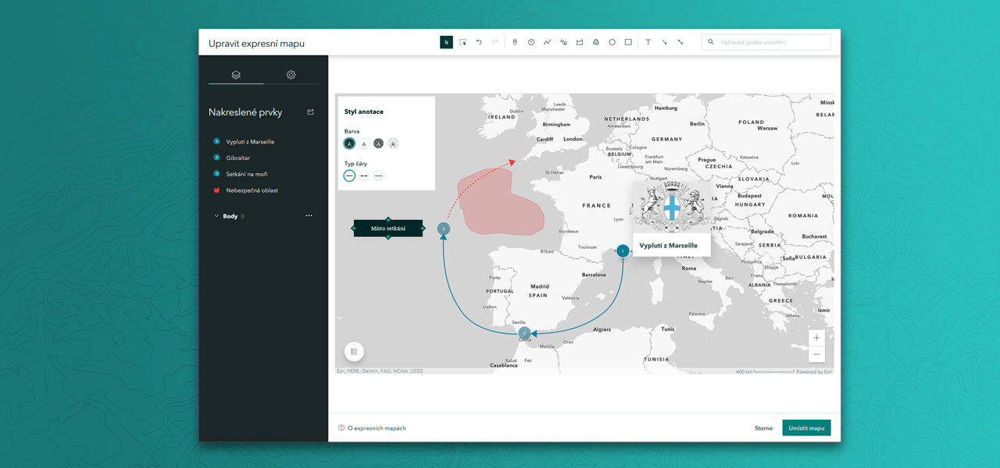
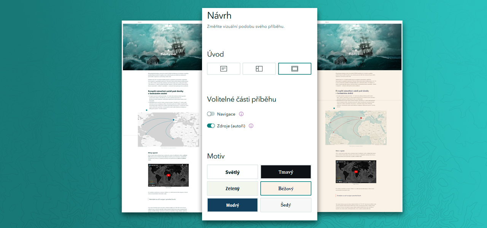

# ArcGIS Online, tvorba webových mapových aplikací

## Cíl cvičení

Náplní cvičení je seznámení s prostředním ArcGIS Online. V rámci cvičení si vyzkoušíte publikaci dat z ArcGIS Pro do ArcGIS Online a jejich využití v opačném směru. Ukážeme si také publikaci standardizovaných mapových služeb pomocí ArcGIS Serveru a to, jak je také lze v prostředí ArcGIS Online využít.

## Základní pojmy

- [**ArcGIS Online**](https://doc.arcgis.com/en/arcgis-online/get-started/get-started.htm) – cloudové prostředí pro ukládání, vizualizaci, tvorbu, správu a vytěžování geografických dat

- **webová služba** – rozhraní, skrze které spolu komunikují servery anebo server & klient; speciálně [webová mapová služba](https://mediaspace.esri.com/media/t/1_05edhhbq) je standard pro komunikaci s tzv. *webovým mapovým serverem* poskytujícím geoprostorová data (mapy, vektorová data, dlaždice, nástroje apod.) prostřednictvím internetu

- **publikace dat** – odeslání lokálně uložené mapové kompozice na server (cloud) a vytvoření datové vrstvy přístupné skrze internet

- [**ArcGIS Server**](https://www.esri.com/en-us/arcgis/products/arcgis-enterprise/overview) – součást řešení ArcGIS Enterprise – vlastní mapový server umožňující publikaci webových mapových služeb

- [**Feature Layer**](https://mediaspace.esri.com/media/t/1_ids5c2qs) – typ dat publikovaných do ArcGIS Online – vektorová vrstva nebo skupina vrstev

- [**Tile Layer**](https://www.esri.com/arcgis-blog/products/sharing-collaboration/sharing-collaboration/best-practices-for-using-tile-layers/) – typ dat publikovaných do ArcGIS Online – rastrová vrstva nebo skupina vrstev využívající dlaždicovou cache pro rychlejší načítání obsahu

- [**kredity**](https://www.esri.com/en-us/arcgis/products/credits/overview) – platební jednotka, pomocí které se uskutečňuje úhrada nákladů za vybrané služby ArcGIS Online (úložiště, geoprocessing, data enrichment, využívání cloudových nástrojů jako je on-line geokódování apod.). Každý student má na začátku alokováno 100 kreditů, aby si mohl vyzkoušet používání služeb, které kredity spotřebovávají

## Použité datové podklady

- data ArcČR 500
- datová sada DATA250 

## Náplň cvičení

# ArcGIS Online: Od dat RÚIAN k webové mapové aplikaci

!!! info "Cíl cvičení"
    V tomto cvičení si vyzkoušíte kompletní publikační a aplikační workflow v prostředí **ArcGIS Pro** a **ArcGIS Online** – od výběru a kartografického zpracování dat ze státní mapové služby RÚIAN přes konfiguraci webové mapy v *Map Vieweru* až po vytvoření a veřejné sdílení interaktivní aplikace v *Instant Apps*.

---

## 1. Připojení webové služby RÚIAN v ArcGIS Pro

Spusťte **ArcGIS Pro** a přes **Map → Add Data → ... from path** připojte mapovou službu ČÚZK s daty budov registru RÚIAN:
   ```text
   https://ags.cuzk.cz/arcgis/rest/services/RUIAN/MapServer/3
   ```
Do mapy se přidala vrstvu **Stavební objekty** (budovy).

---

## 2. Výběr zájmového území (filtrace budov)

Služba RÚIAN obsahuje miliony objektů z celé ČR. Pro rychlou práci a publikaci do cloudu si nejprve vybereme menší prostorový výřez (jednu obec nebo výřez obrazovky) a uložíme jej do lokální geodatabáze projektu.

Výběr podle rozsahu obrazovky

1. Přibližte se v mapě na vybranou obec nebo městskou čtvrt (řádově stovky až nízké tisíce budov).
2. V panelu _Geoprocessing_ zvolte nástroj **Select** a v _Environments_ v části _Processing Extent_ klikněte na první (zelenou) ikonu _Current display extent_. Převezmou se souřadnice rozsahu pohledu.
3. Funkci spusťte. Pokud by kolabovala, přidejte za WHERE podmínku **0 = 0**.
4. Původní službu RÚIAN z mapy odeberte (**Remove**), abyste dále pracovali pouze se svou lokální vrstvou; tu pojmenujte např. `Budovy_vyber`.

!!! warning "Velikost datové sady"
    Nevybírejte celá velká města nebo rozsáhlé regiony – export i následná publikace velkého množství polygonů zbytečně zatěžuje přenos a kreditový limit účtu. Ideální rozsah je **kolem jednoho až pěti tisíc budov**.

---

## 3. Symbolizace vrstvy v ArcGIS Pro

Před publikováním nastavíme základní tematickou symbolizaci přímo v desktopovém prostředí, odkud se přenese i do cloudu.

1. V panelu **Contents** klikněte pravým tlačítkem na vrstvu `Budovy_vyber` a zvolte **Symbology**.
2. V podokně **Symbology** změňte metodu vykreslování na **Unique Values**.
3. Jako pole (**Field 1**) vyberte atribut připojení k plynu (např. `Připojení k rozvodu plynu`).
4. Upravte barevnou paletu a popisky jednotlivých kategorií v legendě (např. *plyn z veřejné sítě*, *bez plynu*, *nezjištěno*) a odstraňte případné nepotřebné kategorie `<all other values>`.

---

## 4. Publikace do ArcGIS Online a přehled služby (Overview)

1. V pravém horním rohu ArcGIS Pro ověřte, že jste přihlášeni ke svému školnímu účtu **ArcGIS Online**.
2. V panelu **Contents** klikněte pravým tlačítkem na vrstvu `Budovy_vyber` a zvolte **Sharing → Share As Web Layer**.
3. V panelu **Share As Web Layer** nastavte:
    * **Name:** unikátní název bez diakritiky (např. `Budovy_Obec_Prijmeni_2026`),
    * **Summary:** stručný popis datové sady,
    * **Tags:** klíčová slova (např. `GISZ`, `RUIAN`, `budovy`),
    * **Layer Type:** **Feature** (vytvoří *Hosted Feature Layer*).
4. Klikněte na **Analyze** (kontrola bez chyb; pokud vyskočí chyba 00374, rozklikněte ji a povolte zaškrtávátko _Allow assignment of unique numeric IDs for sharing web layers_ v okně, které se otevře) a poté na **Publish**.
5. Po dokončení publikace klikněte ve spodní liště oznámení na odkaz **Manage the web layer** (otevře se detail položky v prohlížeči na kartě **Přehled / Overview**).

!!! note "Prohlídka karty Přehled (Overview)"
    Na stránce detailu publikované vrstvy si prohlédněte:
    
    * seznam publikovaných podvrstev (**Layers**),
    * záložku **Data** (náhled atributové tabulky) a **Nastavení / Settings** (možnosti editace a exportu),
    * **URL adresu služby** (vpravo dole) – standardizované REST API rozhraní, přes které lze vrstvu připojovat do dalších aplikací.

---

## 5. Tvorba a konfigurace webové mapy (Map Viewer)

Na kartě **Přehled (Overview)** klikněte na tlačítko **Otevřít v aplikaci Map Viewer (Open in Map Viewer)** a postupně nakonfigurujte jednotlivé prvky webové mapy:

1. **Podkladová mapa (Basemap):**
    * V levém panelu otevřete **Podkladová mapa (Basemap)** a zvolte vhodný podklad (např. *Světlé šedé plátno / Light Gray Canvas* nebo *OpenStreetMap*), který vizuálně nepotlačí tematickou vrstvu budov.
2. **Úprava symboliky a průhlednosti:**
    * V panelu **Vrstvy (Layers)** označte vrstvu budov a v pravém panelu otevřete **Styly (Styles)**. Vyzkoušejte úpravu barev výplně a obrysů polygonů.
    * V pravém panelu přejděte na **Vlastnosti (Properties) → Vzhled (Appearance)** a nastavte vhodnou **Průhlednost (Transparency)** (např. `20–30 %`), aby prosvítal podkladový polohopis.
3. **Popisky (Labels):**
    * V pravém panelu klikněte na **Popisky (Labels)** a zapněte **Povolit popisky (Enable labels)**.
    * Jako popisované pole zvolte číslo popisné/evidenční a nastavte **Viditelný rozsah (Visible range)** tak, aby se popisky zobrazovaly až při větším přiblížení.
4. **Konfigurace vyskakovacích oken (Pop-ups):**
    * V pravém panelu otevřete **Vyskakovací okna (Pop-ups)**.
    * **Nadpis (Title):** upravte titulek s využitím dynamického atributu ve složených závorkách (např. `Budova č. {cisladomovni}`).
    * **Seznam polí (Fields list):** odeberte systémové sloupce (`OBJECTID`, `Shape__Area`, `Shape__Length`), identifikátory a ponechte jen uživatelsky srozumitelné atributy (např. počet podlaží, plyn, vodovod, kanalizace).
    * **Multimédia nebo graf:** klikněte na **Přidat obsah (Add content)** a vložte **Graf (Chart)** (např. pomocí **Select Fields** porovnání atributů _Podlahová plocha_ a _Zastavěná plocha_) nebo **Obrázek (Image)** s ilustrační fotografií/odkazem.
5. **Přidání dalších dat z ArcGIS Online:**
    * V levém panelu klikněte na **Přidat (Add) → Procházet vrstvy (Browse layers)**.
    * Přepněte zdroj na **ArcGIS Online** nebo **Living Atlas**, vyhledejte doplňkovou kontextovou vrstvu (např. administrativní hranice obcí/ORP nebo nějaké pasporty, vrstvy životního prostředí apod.) a zkuste ji přidat do mapy. Můžete také vyhledat vrstvu **Základní topografické mapy ČR (Web Mercator)**, rozkliknout její vlastnosti a tlačitkem **Use as basemap** nahradit podkladovou mapu touto ZTM.
6. **Nastavení filtru (Filter):**
    * Vyberte vrstvu budov, v pravém panelu klikněte na **Filtr (Filter) → Přidat výraz (Add expression)** a nastavte podmínku (např. zobrazení pouze budov připojených na plyn nebo budov s více než 2 nadzemními podlažími).
7. **Uložení webové mapy:**
    * V levém panelu zvolte **Uložit a otevřít (Save and open) → Uložit jako (Save as)** a mapu uložte (např. `Webmapa_Budovy_Prijmeni_2026`).

---

## 6. Převod Web Map → Web App (Instant Apps)

Webová mapa slouží jako datový a kartografický základ. Nyní ji zabalíme do samostatného uživatelského rozhraní s ovládacími prvky.

1. V prostředí **Overview** vaší webmapy klikněte v pravém panelu na **Vytvořit aplikaci (Create app)** a zvolte **Instant Apps**.
2. Prohlédněte si nabídku šablon podle účelu použití (např. *Postranní panel / Sidebar*, *Základní / Basic*, *Interaktivní legenda / Interactive Legend*, *Posuvník / Swipe*).
3. Vyberte šablonu **Basic**.
4. Zadejte název aplikace (např. `Aplikace_Budovy_Prijmeni`) a potvrďte **Vytvořit aplikaci (Create app)**.

---

## 7. Konfigurace Instant App mimo režim Express

Výchozí průvodce *Express* nabízí pouze zjednodušené nastavení. Pro plnou kontrolu nad funkcemi a ovládacími prvky aplikace jej přepneme do pokročilého režimu.

1. V levém horním rohu konfiguračního panelu **vypněte přepínač Express** (potvrďte přechod do plného režimu konfigurace).
2. Projděte jednotlivé sekce v levém menu a aktivujte vybrané funkce a „widgety“:
    * **Mapa (Map):** zkontrolujte připojenou webovou mapu, výchozí rozsah zobrazení a navigační prvky (tlačítko domů, měřítko).
    * **O aplikaci (About):** doplňte úvodní informační text o datech RÚIAN a zapněte zobrazení **Legendy (Legend)** a **Seznamu vrstev (Layer List)** v postranním panelu.
    * **Interaktivita (Interactivity):** povolte nástroje **Vyhledávání (Search)**, **Měření (Measure)**, **Přepínač podkladových map (Basemap toggle)**, případně **Záložky (Bookmarks)** a **Sdílení (Share)**. Můžete si zkusit proklikat i další nástroje/možnosti, např. swipe pro prolínání, filtr pro předpřipravené atributové dotazy apod.
    * **Motiv a rozvržení (Theme & Layout):** upravte barevné ladění horní lišty a rozložení ovládacích prvků na obrazovce.

??? tip "Průběžný náhled (Preview)"
    V horní liště konfigurátoru můžete kdykoli přepínat mezi zobrazením pro **počítač, tablet a mobilní telefon** a ověřit responzivitu nastavených prvků.

---

## 8. Publikace a veřejné sdílení (Everyone)

1. Po dokončení nastavení klikněte v pravém dolním rohu na **Publikovat (Publish)** a potvrďte.
2. V okně sdílení (nebo na kartě **Obsah / Content** v ArcGIS Online) nastavte úroveň sdílení na **Všichni (veřejné) / Everyone (public)**.

!!! danger "Kontrola sdílení všech navázaných položek"
    Aby aplikaci mohl otevřít kdokoli bez přihlášení, musí být na úroveň **Všichni (veřejné) / Everyone (public)** nastaveny **všechny** tyto položky najednou:
    
    * samotná **Webová mapová aplikace** (*Instant App*),
    * podkladová **Webová mapa** (*Web Map*),
    * zdrojová **Hostovaná vrstva prvků** (*Hosted Feature Layer*) s budovami RÚIAN.
    
    *ArcGIS Online vás na nesoulad oprávnění obvykle upozorní dialogovým oknem – aktualizaci oprávnění v něm potvrďte.*

3. Zkopírujte veřejný odkaz na spuštěnou aplikaci a **otevřete jej v anonymním okně prohlížeče**, abyste ověřili, že se mapa, data i pop-upy načítají bez výzvy k přihlášení.

---

## Co jse se naučili

- [ ] V ArcGIS Pro byla připojena služba RÚIAN a vyexportován omezený výběr budov.
- [ ] Vrstva je publikována jako **Hosted Feature Layer** v ArcGIS Online.
- [ ] Webová mapa v **Map Vieweru** má upravenou podkladovou mapu, průhlednost, popisky, filtr, přidanou doplňkovou vrstvu z AGOL a pop-up s grafem nebo multimédii.
- [ ] Aplikace v **Instant Apps** byla nakonfigurována mimo režim *Express*.
- [ ] Aplikace, webová mapa i vrstva jsou sdíleny jako **Everyone (public)** a otestovány v anonymním okně.


## Další úloha k procvičení

!!! task-fg-color "Úlohy"

    K řešení následují úlohy použijte datovou sadu ArcČR
    500 ve verzi 3.3 a DATA250(oboje dostupné na disku *S* ve složce
    ``K155\Public\data\GIS\``). Zde také případně najdete soubor s
    popisem dat ve formátu PDF. 
    
    1. **Vytvořte mapu obcí s rozšířenou působností jednoho z krajů ČR.**

        Použijte data ORP z datové sady ArcČR
        (ObceSRozsirenouPusobnosti_Polygony), vyexportujte do nové třídy prvků
        pouze zvolený kraj. Mapu doplňte zastavěnými oblastmi obcí nad 5 tisíc
        obyvatel (plošky z třídy prvků POP/BuiltupA datové sady DATA250, které jsou větší než 1,6 ha). Tyto zastavěné plošky neobsahují název obce – připojte pomocí Spatial Join z vrstvy Obce_Polygony.

        Vyexportujte mapu (Share ► Web Layer ► Publish web layer) a umístěte
        na ArcGIS Online do svého umístění. Jako typ zvolte Feature Service,
        nikoli Tile Layer. Můžete nasdílet se skupinou CTU Prague.

        Jednotlivé plochy ORP popište. Barevnost zvolte tak, aby z mapy byla
        zároveň poznat i příslušnost ORP k okresům (ORP jsou do okresů
        skladebné).


    2. **Vyexportujte shapefile silnic a železnic ve vašem kraji.**

        Použijte příslušné vrstvy z ArcČR, ořízněte na velikost kraje.

        Připravte si také vrstvu vodních ploch (VodniPlochy_Polygony),
        ořízněte ji na plochu kraje a uložte do své složky jako shapefile,
        poslouží později.


    3. **Vyzkoušejte si vytvořit mapovou kompozici kraje s využitím dat z různého umístění.**

        V mapové kompozici můžete využívat data umístěná v různých formátech:

        - data z ArcGIS Online nebo z vlastního Portal for ArcGIS,
        - data z WMS, WMTS služeb,
        - data ze služeb ArcGIS Serveru,
        - data z WFS služeb,
        - souborová data uložená jako SHP, CSV, GPX aj.,
        - dynamické vrstvy *Živého atlasu Esri*

    4. **Vyzkoušejte si práci s úpravou pop-up (kontextového menu s atributy, které se zobrazí po  kliknutí), s nastavením stylu apod.**

    # Základní buildery webových mapových aplikací: Instant Apps & Story Maps

## ArcGIS Instant Apps: webová mapová aplikace během několika minut

ArcGIS Instant Apps představují revoluční nástroj pro tvorbu interaktivních mapových aplikací přímo ve vašem prohlížeči. Ať už potřebujete jednoduchou aplikaci pro zobrazení mapy, nebo komplexní nástroj pro sběr dat v terénu, Instant Apps vám umožní vytvořit profesionální a responzivní aplikaci během několika minut.

Proč zvolit ArcGIS Instant Apps?
Instant Apps se vyznačují svou jednoduchostí a rychlostí. Díky intuitivnímu rozhraní a předpřipraveným šablonám můžete vytvořit plně funkční aplikaci i bez znalosti programování. Stačí vybrat šablonu, přizpůsobit ji svým potřebám a aplikaci publikovat. Kromě toho jsou Instant Apps plně responzivní, což znamená, že se automaticky přizpůsobí velikosti obrazovky, ať už je používáte na počítači, tabletu nebo mobilním telefonu.

### Fungování Instant Apps

Tvorba aplikace pomocí Instant Apps je intuitivní a skládá se z několika klíčových kroků. Nejprve si vyberete šablonu, která nejlépe odpovídá vašim potřebám. Instant Apps nabízí širokou škálu předpřipravených šablon pro různé účely, od jednoduchého prohlížení map až po sběr dat v terénu. Každá šablona má specifické funkce a rozložení, které si můžete dále přizpůsobit. Následuje konfigurace aplikace, kde pomocí intuitivního rozhraní upravíte název, popis, ikonu, barvy a další parametry. Důležitým krokem je přidání obsahu, tedy map, vrstev, grafů a dalších prvků, které chcete v aplikaci zobrazit. Všechny potřebné nástroje a nastavení najdete v přehledném rozhraní. Nakonec, když jste s aplikací spokojeni, ji jednoduše publikujete a můžete ji sdílet s ostatními uživateli. Celý proces je navržen tak, aby byl rychlý a srozumitelný i pro uživatele bez znalosti programování.

**Dostupné šablony a jejich stručný popis:**

- **Nearby**: Umožňuje uživatelům vyhledávat body zájmu (např. restaurace, obchody, památky) v blízkosti zadané adresy. Ideální pro aplikace typu "najdi nejbližší".
- **3D Viewer**: Zobrazuje 3D scény s interaktivními nástroji pro navigaci a analýzu. Skvělé pro prezentaci 3D modelů měst, terénu nebo budov.
- **Atlas**: Prezentuje sbírku map a vrstev s možností vyhledávání, prohlížení a zkoumání. Vhodné pro aplikace typu "mapový průvodce".
- **Countdown**: Zobrazuje odpočet do určité události (např. konference, výstavy, termínu odevzdání).
- **Chart**: Umožňuje vytvářet interaktivní grafy z vašich dat (např. sloupcové, koláčové, čárové).
- **Directions**: Nabízí navigaci a výpočet trasy mezi dvěma body. Užitečné pro aplikace s dopravní tématikou.
- **Edit**: Umožňuje uživatelům editovat prvky ve vaší mapě (např. přidávat, mazat nebo upravovat body, linie a polygony).
- **Filter**: Umožňuje filtrovat prvky ve vaší mapě podle různých kritérií (např. typ, kategorie, hodnota).
- **Fullscreen**: Zobrazuje mapu na celou obrazovku pro maximální vizuální zážitek.
- **Legend**: Zobrazuje legendu k mapě pro lepší orientaci v datech.
- **Media**: Umožňuje přidávat do aplikace obrázky, videa a další média pro obohacení obsahu.
- **Popup**: Zobrazuje interaktivní okno s informacemi o vybraném prvku v mapě.
- **Search**: Umožňuje vyhledávat místa a adresy v mapě pomocí textového vyhledávání.
- **Sidebar**: Zobrazuje postranní panel s doplňujícími informacemi, nástroji nebo ovládacími prvky.
- **Sketch**: Umožňuje uživatelům kreslit a přidávat poznámky do mapy (např. značky, čáry, polygony).
- **Swipe**: Umožňuje porovnávat dvě mapy pomocí posuvníku (např. pro zobrazení změn v čase nebo rozdílů mezi scénáři).
- **Time**: Umožňuje zobrazovat data v čase pomocí časové osy nebo animace.


## ArcGIS Story Maps: Mapy s příběhem

V prostředí ArcGIS StoryMaps dokážete vytvořit zajímavé a inspirující příběhy, které využívají potenciál map. Díky nim totiž můžete lépe ilustrovat prostorové vztahy, které jsou ve vašem vyprávění důležité, dodat informacím vizuální přitažlivost a zvýšit jejich důvěryhodnost.

Při tvorbě můžete použít webové mapy ArcGIS, ale můžete si udělat i vlastní mapy, přidávat text, fotografie nebo videa, a vytvořit tak interaktivní prezentaci, kterou lze snadno publikovat a sdílet. Mapy s příběhem poskytnou širší kontext tématům, jako jsou například blogové články, informace veřejné správy určené pro veřejnost či výsledky vědeckých výzkumů.

[<span>https://www.arcdata.cz/cs-cz/produkty/arcgis/arcgis-storymaps/galerie</span><br>Galerie map s příběhem](https://www.arcdata.cz/cs-cz/produkty/arcgis/arcgis-storymaps/galerie){ .md-button .md-button--primary .server_name .external_link_icon_small target="_blank"}
{: .button_array}

### Fungování StoryMaps
**Vyprávění příběhů přesně podle vás**

Mapy s příběhem jsou nástroj pro sestavení videa, fotografií a dalšího obsahu do přesvědčivého a interaktivního vyprávění, které lze snadno publikovat a sdílet. V intuitivním editačním prostředí můžete text přehledně formátovat, použít profesionálně navržené styly a vše doplnit webovými mapami.

<figure markdown>

</figure>

**Jednoduchá tvorba expresních map**

Díky expresním mapám můžete vytvářet praktické a estetické mapy, aniž byste museli opustit aplikaci ArcGIS StoryMaps. Během několika minut navrhnete vlastní interaktivní mapu a přidáte body, vyskakovací okna nebo šipky, které váš příběh obohatí. Můžete také použít své stávající webové mapy a scény, vytvořit novou mapu pomocí demografických dat anebo si vybrat z hotových map na ArcGIS Living Atlas of the World.

<figure markdown>

</figure>

**Prezentace dat v moderním designu**

Jedním kliknutím můžete změnit celý vzhled. Snadno si tak můžete vyzkoušet různé motivy designu a vybrat si ten, který se k vašemu příběhu hodí nejlépe – není třeba stylizovat každý prvek zvlášť. Styly je navíc možné upravit podle firemních barev a firemního loga. Na své publikum tak zapůsobíte profesionálně vypadajícím obsahem.

<figure markdown>

</figure>

### Doplňková úloha: StoryMap
S tvorbou storymapy se nejlépe seznámíte v samotném builderu, který je velmi intuitivní. Za tímto účelem si připravte itinerář z dovolené nebo nějaké cesty. Ideálně strukturovanou tabulku s místy, které jste navštívili, a ke každé lokalitě fotku. Pokud nebudete mít vlastní fotografie, využijte např. Wikimedia Commons.

#### Příprava dat
-   struktura tabulky např. v xlsx může být následující: ID, City, State.
-   ideálně cca 10–20 záznamů/lokalit
-   fotografie může být v libovolném formátu pro každý záznam v tabulce

#### Pracovní postup
1.  Jelikož vaše tabulka neobsahuje souřadnice a nelze ji tak umístit jako prostorovou vrstvu, importujte ji do ArcGIS Pro jako obyčejnou tabulku a poté na ni klikněte pravým tlačítkem myši a vyberte možnost *Geocode addresses*, čímž se načte průvodce geokódováním, který je velmi návodný. Projděte geokódování, nastavte všechny paramtery, nezapomeňte odhadnout kredity a spustit operaci.

2.  U geokódovaných adres může být několik výsledků dle míry pravděpodobnosti správného určení lokality: *Matched, Tied, Unmatched*. Nyní můžete geokódované adresy projít a případně opravit chybně určené lokality (geocoding u každé lokality eviduje více kandidátů, ze kterých lze vybrat; tento proces nazýváme *Rematching*).

3.  Jakmile bude geokódovaná vrstva zkontrolována, publikujte ji na ArcGIS Online (*Share as a web layer*).

4.  Na svém ArcGIS Online účtu spustťe tvorbu nové StoryMapy (Obsah > Vytvořit Aplikaci > ArcGIS StoryMaps).

5.  Okamžitě je spuštěn builder, který je koncipován velmi jednoduše. Pomocí ikony **+** přidáváte různé formy obsahu. Navrhněte název a krátký popis cesty.

6.  Stěžejní částí však bude příběhová mapa zastávek vaší cesty; z nabídky obsahu vyberte v kategorii *Poutavý obsah* položku *Boční blok* (další design je na vás). Důležité je do mapového obsahu nahrát vámi publikovanou mapu zastávek a další postup probíhá způsobem, že doplňujete obsah plovoucího okna s textem a médii (zde krátký popis zastávky + fotografie), který propojujete s polohou v mapě. Na ose pod mapovým oknem pak přidáváte další snímek s novou polohou a novým obsahem, čímž vznikne základ storymapy (ve formě scrollytelly). Vyzkoušejte si ideálně co nejvíce prvků a možností přidání obsahu (lze vložit video, audio, iframe, ...).

7.  Dokončete všechny náležitosti a storymapu publikujte. Odevzdává se pouze URL storymapy. Ilustrativní ukázka níže.

<div style="text-align: center;">
<iframe width="1200" height="900" src="https://storymaps.arcgis.com/stories/291bb1f64f8b491ba2264d99b427dfe4" title="Ukázka ArcGIS StoryMap" frameborder="0" allow="accelerometer; autoplay; clipboard-write; encrypted-media; gyroscope; picture-in-picture; web-share" referrerpolicy="strict-origin-when-cross-origin" allowfullscreen></iframe>
</div>
